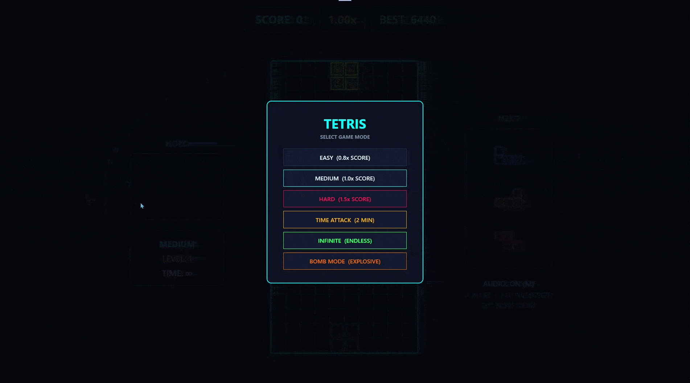

# Tetris — OpenGL 3.3 Edition


A modern, hardware-accelerated implementation of Tetris built with **C#**, **.NET 8**, **WPF**, and **OpenTK 4 (OpenGL 3.3 Core)**. Designed with a strictly decoupled, zero-magic-number architecture, procedural GLSL neon shaders, real-time RIFF/WAVE audio synthesis, official Super Rotation System (SRS) wall kicks, and six distinct gameplay modes.

---

## Visual Showcase

| Mode Selection & Responsive HUD | Bomb Detonation & Rainbow Combo Banner |
| :---: | :---: |
|  |  |

---

## Tech Stack & Dependencies

| Component | Technology / Library | Purpose |
| :--- | :--- | :--- |
| **Runtime & Language** | `.NET 8.0` / `C# 12` | Core application runtime, async game loop, and pattern matching |
| **Desktop Host & HUD** | `Windows Presentation Foundation (WPF)` | Resolution-independent `Viewbox` scaling, vector block previews, and storyboard animations |
| **Graphics Binding** | `OpenTK 4.8.2` & `OpenTK.GLWpfControl 4.3.3` | Hardware-accelerated OpenGL 3.3 Core context hosted inside WPF |
| **Shading Language** | `GLSL 330 Core` | Procedural gridlines, distance-field neon borders, ghost projection, and radial spark particles |
| **Audio Synthesis** | `System.Media.SoundPlayer` + `BinaryWriter` | In-memory 44.1 kHz 16-bit PCM WAV generation without external audio assets |
| **Persistence** | `System.Text.Json` | Local JSON serialization for per-mode high scores and player telemetry |

---

## Key Features

* **Hardware-Accelerated OpenGL 3.3 Pipeline:** Renders the entire playfield using a single GPU-resident unit quad (`VAO`/`VBO`/`EBO`) and custom fragment shaders—no static sprite textures required on the board.
* **6 Distinct Gameplay Modes:**
  * **Easy (`0.8x`):** Relaxed drop speed and gentle acceleration curve.
  * **Medium (`1.0x`):** Standard tournament pacing and scoring.
  * **Hard (`1.5x`):** High-velocity gravity with increased score multiplier.
  * **Time Attack (`1.25x`):** 2-minute countdown race against the clock.
  * **Infinite (`1.0x`):** Endless survival mode that purges the top half of the grid upon overflow instead of ending the session.
  * **Bomb Mode (`1.2x`):** Probabilistic explosive `BombBlock` spawns that obliterate adjacent rows on impact.
* **Official SRS Wall Kicks (`WallKickData.cs`):** Implements standard and `I`-tetromino Super Rotation System offset tables, allowing pieces to kick off walls and stacked blocks during rotation.
* **Dynamic Combo & Multi-Line Multiplier:** Rewards consecutive line clears (`+0.25x` per streak) and multi-line clears (Single, Double, Triple, Tetris) with animated rainbow HUD banners.
* **GPU Particle System & Camera Shake:** Semi-implicit Euler particle bursts and damped projection-matrix shake triggered via decoupled C# observer events.
* **Zero-Asset Procedural Audio:** Synthesizes retro square-wave sweeps and white-noise explosions in RAM at startup.
* **Persistent High Scores:** Automatically tracks best scores, maximum combo streaks, and cleared lines per mode in `%LocalAppData%\NeonTetris\stats.json`.
* **App-Ready Core Architecture:** All game rules, collision math, SRS tables, and state transitions (`GameSessionState`) are isolated from WPF/OpenGL for straightforward porting to mobile platforms (.NET MAUI / Avalonia).

---

## Project Structure

```text
Tetris/
├── Audio/
│   └── SoundEngine.cs              # In-memory RIFF/WAVE PCM procedural synthesizer
├── Core/
│   ├── BombBlock.cs                # Special 1x1 explosive tetromino definition
│   ├── BonusNotification.cs        # Immutable payload for HUD combo/level banners
│   ├── GameMode.cs                 # GameMode enum & immutable rule configurations
│   ├── GameSessionState.cs         # Explicit state machine (ModeSelection, Playing, Paused, GameOver)
│   ├── GameStatistics.cs           # JSON persistence repository for per-mode telemetry
│   ├── ScoreCalculator.cs          # Multi-line base scoring & combo streak multiplier logic
│   └── WallKickData.cs             # Official SRS wall-kick offset lookup tables
├── Rendering/
│   ├── Shaders/
│   │   ├── standard.vert           # Orthographic MVP vertex shader
│   │   ├── grid_bg.frag            # Procedural UV grid with sinusoidal neon wave
│   │   ├── neon_block.frag         # Distance-field glowing block & translucent ghost shader
│   │   └── particle.frag           # Analytical radial glow shader for spark bursts
│   ├── CameraShake.cs              # Damped random projection offset controller
│   ├── ParticleSystem.cs           # Euler-integrated 2D spark physics & batch renderer
│   ├── QuadMesh.cs                 # Unit-quad VAO/VBO/EBO GPU buffer wrapper
│   ├── Shader.cs                   # Runtime GLSL compiler, linker & uniform helper
│   └── TetrisRenderer.cs           # Main OpenGL 3.3 scene orchestrator
├── UI/
│   └── BlockPreviewRenderer.cs     # Procedural vector neon renderer for Hold & Next queues
├── Assets/                         # Fallback tetromino icon assets
├── Block.cs                        # Abstract tetromino base class with rotation states
├── IBlock.cs ... ZBlock.cs         # Concrete 7 standard tetromino implementations
├── BlockQueue.cs                   # Probabilistic 3-piece preview queue
├── GameGrid.cs                     # 22x10 logical playfield matrix & row collapse operations
├── GameState.cs                    # Decoupled core game loop state & observer event publisher
├── MainWindow.xaml                 # Viewbox-scaled dark neon UI, overlays & rainbow storyboards
├── MainWindow.xaml.cs              # Input routing, OpenGL loop host & event mediator
└── Tetris.csproj                   # .NET 8 project configuration & shader copy rules
```

---

## Controls

| Key | Action |
| :--- | :--- |
| `Left` / `Right` | Move piece horizontally |
| `Down` | Soft drop |
| `Space` | Hard drop (instant lock + spark burst) |
| `E` | Rotate clockwise (with SRS Wall Kick) |
| `Q` | Rotate counter-clockwise (with SRS Wall Kick) |
| `W` | Hold / swap active piece |
| `P` | Pause / Resume (masks playfield) |
| `M` | Mute / Unmute procedural audio |
| `F11` | Toggle borderless fullscreen |
| `Esc` | Return to Game Mode selection menu |

---

## Getting Started

### Prerequisites
* **OS:** Windows 10 / 11 (x64)
* **SDK:** [.NET 8.0 SDK](https://dotnet.microsoft.com/download/dotnet/8.0) or Visual Studio 2022 (`17.8+`)
* **GPU:** Any graphics adapter supporting **OpenGL 3.3 Core** or higher

### Build & Run via CLI

```bash
# 1. Clone the repository
git clone [https://github.com/RodeMartin/Tetris.git](https://github.com/RodeMartin/Tetris.git)
cd Tetris

# 2. Restore NuGet packages (OpenTK & GLWpfControl) and build
dotnet build --configuration Release

# 3. Run the application
dotnet run --configuration Release
```

### Build & Run via Visual Studio 2022
1. Open `Tetris.sln` in Visual Studio 2022.
2. Ensure the solution configuration is set to **Release** or **Debug** (`Any CPU`).
3. Press **`F5`** to build and launch.

---

## Release Milestones

* **`v.0.1` — Core Engine & Classic Gameplay:** Decoupled C# logic layer (`GameGrid`, `GameState`, `BlockQueue`) with initial WPF software rendering.
* **`v.0.2` — OpenGL 3.3 Pipeline & VFX:** Hardware-accelerated rendering via OpenTK 4, programmable GLSL neon shaders, GPU particle system, camera shake, and dark neon UI.
* **`v.0.3` — Game Modes, SRS Physics & Procedural Audio:** Added 6 game modes, SRS wall kicks, combo multipliers, rainbow bonus notifications, `Viewbox` fullscreen scaling, `SoundEngine` PCM synthesis, and JSON high-score persistence.
